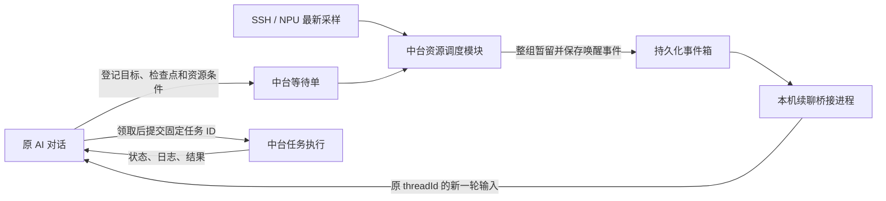
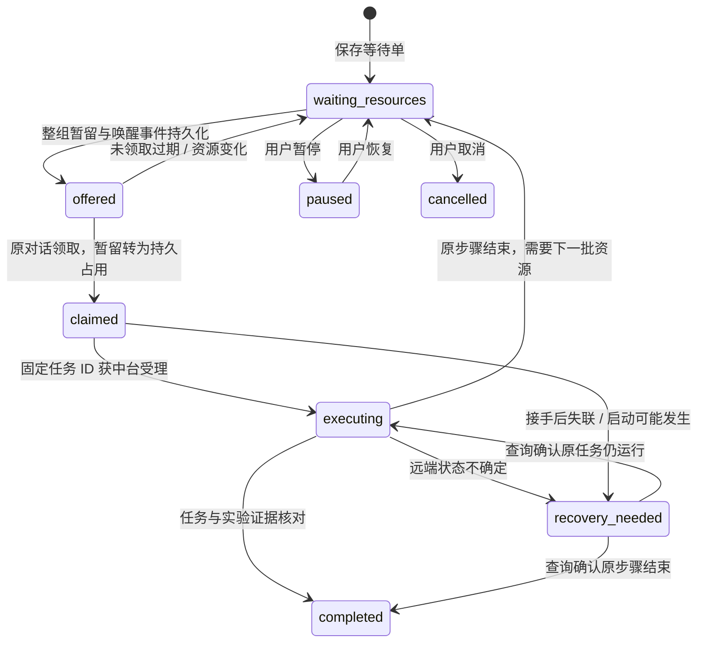

# AI 实验等待与原对话恢复机制

本文保留开发前方案；源码版本的实际字段、命令及宿主边界以 [实验等待运行说明](../experiment-continuations.md) 为准。

## 0. 文档控制

| 字段 | 内容 |
|---|---|
| 产品 / 特性 | simpleHtmlWatch / 资源等待与 AI 原对话恢复 |
| 分析日期 | 2026-10-10，北京时间 |
| 状态 | 开发前方案草稿，接口和默认值均为提案 |
| 目标决策 | 确定等待协议、资源判断、续聊路线及首版范围 |
| 需求负责人 / 验收人 | 用户；具体阈值和试点实验待确定 |
| 技术负责人 / 维护者 | 开发实施时指定，不假定本次设计包含部署授权 |
| 调研基线 | 本仓库 `48a1f3a`；本机 Codex CLI `0.162.1`；官方文档访问日期同上 |

## 1. 建议与成功标准

建议采用“持久化等待单 → 资源匹配 → 整组暂留 → 原对话唤醒 → AI 领取 → 原实验继续”的机制。AI 因资源不足结束当前回复时，应将实验登记为 `waiting_resources`，同时留下恢复入口；中台承担后续等待。

首版应以一个实例、一个受支持的 AI 宿主、整机独占为范围。中台应在北京时间 12:30–14:00、02:30–06:00 的入口立即检查，并在其他时间每 10 分钟检查；数量和条件满足时应触发原对话继续。波谷只改变检查时机，不构成资源已空闲的证据。

成功应以“原对话接手并提交原实验下一步”衡量，分开记录资源发现、唤醒送达、AI 领取、任务受理、远端启动、结果回收和实验结论。收到唤醒回执不能作为实验运行或成功的证据。

推荐正式路线为中台资源调度模块加本机续聊桥接进程。原对话定时心跳可作为较小的试点路线，先验证恢复上下文与领取协议，但定时轮询与中台主动推送应分别验收。

## 2. 背景与基线

用户指出：AI 经常申请不到机器后报告阻塞，实验随当前回复结束而停止，错过之后出现的空闲资源。应解决的是跨回复的实验连续性，而不是让一次模型调用一直占着连接等待。

调研材料应作为设计约束使用：

| 设计约束 | 依据与边界 |
|---|---|
| 任务和资源占用必须可恢复 | `internal/watch/tasks.go`、`docs/task-controller.md` 的持久化与恢复协议 |
| SSH ready 与 NPU 空闲应分别判断 | `TaskManager.readyForReservationLocked` 的选择条件不解析 NPU 占用 |
| 原预留不能依超时释放 | `internal/watch/reservations.go` 中预留无 TTL，未结束关联任务阻止释放 |
| 多机应作为一个分配对象 | `TaskRequest` 为单机请求；不能以依次预留 N 台模拟原子整组分配 |
| 机器别名不能重复计数 | `machineResource` 用 `resourceId` 或 host 表示物理资源 |
| 小时平均只能帮助观察波谷 | `internal/watch/utilization_parse.go` 聚合机器均值并舍弃卡行，不适合判定所有卡当前空闲 |
| 服务身份必须重新发现 | `docs/service-lifecycle.md` 的 serviceId、runId、版本及能力校验 |
| 预留是协作协议 | 人工 SSH、即时执行、其他实例不会自动遵守本实例预留 |

不做此改造时，仍需用户手工回到原对话继续，或让每个 AI 自己反复判断资源。问题频率、平均等待时间和错过的窗口数量暂无统计，应在试点中记录，不能据此虚构收益比例。

## 3. 用户任务与职责

当一个已获运行授权的实验因为机器不足而不能继续时，用户需要系统保留实验目标和进度，在符合条件的资源出现后继续原对话与实验，避免重述上下文、重复启动和资源冲突。

| 参与者 | 拟承担的职责 |
|---|---|
| 用户 | 指定目标、资源范围、允许自动继续的实验与预算；可暂停或取消 |
| 原 AI 对话 | 保存检查点，登记等待，恢复时核对原任务并执行下一步 |
| 中台 | 保存等待单，判断资源，分配整组资源，维护领取与任务关联 |
| 本机桥接进程 | 将事件送往绑定的 AI 宿主和原对话，记录 turnId 与送达证据 |
| 实例维护者 | 负责准确实例的启停、升级及兼容迁移 |

用户明确授权的实验和自动继续范围应持久化，恢复后不应重复索要相同授权。超出原授权的新实验、预算变化和资源范围扩大应另行确定。

## 4. 根因、假设与目标

问题的设计根因假设是：资源申请失败没有生成持久化的恢复责任，也没有能够向原对话发起下一轮执行的宿主入口。源码调研能够确认任务调度接口的边界，但不能证明所有 AI 中断都由此引起。

| 假设 | 验证方式 | 错误时的处理 |
|---|---|---|
| “10 分钟”指检查周期 | 本次设计暂按每 10 分钟检查；用户可改为连续空闲 10 分钟 | 分离 `checkEverySeconds` 与 `stableForSeconds`，不混为同一设置 |
| 机器范围可用标签 / 型号 / 拓扑描述 | 用首个实际实验给出资源合同 | 缺失必需信息时标记未知，不自动扩大范围 |
| 目标 AI 能按 ID 继续原对话 | 用明确选定的测试对话验证 | 采用宿主心跳；不能用新建对话冒充恢复 |
| 低负载窗口能增加可运行机会 | 记录原始资源快照与等待时间 | 时间窗口只作策略，不预设性能收益 |

目标应是：等待不丢失、资源分配不冲突、恢复不串对话、同一步实验不重复执行、恢复链路可观测。

## 5. 范围与系统上下文

范围应包含：等待登记、资源条件判断、整组暂留与领取、原对话恢复、失败恢复、暂停取消、日志与页面展示。

首版不应包含跨实例资源协调、卡级共享调度、任意 AI 平台适配、自动终止远端任务或重建实验。需要多节点同时启动的实验应单独验证启动协议；整组预留不能证明分布式启动原子性。



裁剪说明：本次以个人实验流程为边界，不开展组织访谈、市场规模分析或模型质量基准。方案不改变实验算法；应验证调度与恢复行为，不把算子精度或硬件性能写成中台验收结果。

## 6. 行为与数据合同

### 6.1 触发策略

所有时间应按 `Asia/Shanghai` 解释，窗口采用半开区间 `[12:30,14:00)`、`[02:30,06:00)`，不跟随机器本地时区漂移。

| 事件 | 拟执行行为 |
|---|---|
| 等待单登记 | 立即检查一次，够资源则进入暂留 |
| 12:30 / 02:30 进入波谷 | 立即检查；进程错过入口后恢复时，应检查当前是否仍在窗口 |
| 常规检查 | 每 600 秒检查等待队列，不调用模型来计算是否空闲 |
| 波谷期间 | 建议将资源检查周期缩为 60 秒，可配置 |
| 中台任务完成 / 预留释放 | 立即再评估等待队列，可合并短时间内的同类事件 |

候选分配条件应为：等待单启用、授权有效、处于可检查时机、满足全部资源条件的独立物理机器不少于所需数量、没有正在处理的同代唤醒事件。

若选择“连续空闲 10 分钟”，应设置 `stableForSeconds=600` 并以较密的原始采样证明连续性。任一卡忙碌、采样缺失、过期、机器离线或跨过允许的采样间隔，都应重置稳定计时。每 10 分钟看一次或两个端点空闲不能证明中间一直空闲。

### 6.2 资源合同

每张等待单应描述机器组 / 指定范围、机器数量、硬件型号、每机所需卡数、显存和必要网络拓扑 / 软件环境。首版应使用整机独占并按物理 `resourceKey` 去重。

`eligible` 应由以下条件共同构成：

1. 机器属于用户授权范围，型号、卡数、互联及环境符合实验要求。
2. SSH 监控新鲜，本实例无未完成 / unknown 任务、原预留、其他等待单暂留或领取占用。
3. 所需设备的最新 NPU 采样完整、成功且未截断；按单设备判断进程、利用率、可用显存等必需项。
4. 正式暂留前重新核对快照，AI 领取及提交前再检查；外部占用发生变化应退回等待。

不能以机器均值低替代所有必需设备空闲，不能以 Python 进程列表代替 NPU 进程表，不能以 HTTP/SSH 可达推断硬件健康。未知值应返回明确原因，例如 `npu_sample_stale`、`memory_unknown`、`topology_mismatch`，不计入合格数量。

利用率阈值、显存下限和采样最大年龄应在首个实验合同中定义。可将“每设备利用率不高于 5%、无计算进程、显存达到实验预算、采样不超过 60 秒”作为试点候选，不能当成通用硬件事实。取样新鲜度应参考相关命令的完成时间，不能只看其他命令更新过的机器 `UpdatedAt`。

### 6.3 等待单与检查点

以下为拟议数据结构，ID 和机器名仅为例子，不是实际对话或资源：

```json
{
  "schema": "simplehtmlwatch.continuation.v1",
  "id": "exp-001-step-03-wait",
  "experimentId": "exp-001",
  "stepId": "step-03",
  "generation": 1,
  "target": {
    "provider": "codex",
    "hostId": "local",
    "threadId": "EXPLICIT_ORIGINAL_THREAD_ID",
    "workspace": "/absolute/path/to/experiment"
  },
  "resources": {
    "group": "A3-test-pool",
    "machineCount": 2,
    "hardware": "A3",
    "devicesPerMachine": 8,
    "allocation": "whole-machine-exclusive"
  },
  "policy": {
    "timezone": "Asia/Shanghai",
    "windows": ["12:30-14:00", "02:30-06:00"],
    "checkEverySeconds": 600,
    "windowCheckEverySeconds": 60,
    "stableForSeconds": 0
  },
  "checkpoint": {
    "path": "/absolute/path/to/experiment/checkpoint.json",
    "digest": "CHECKPOINT_DIGEST"
  },
  "authorizationRef": "LOCAL_AUTHORIZATION_RECORD",
  "existingTaskIds": [],
  "state": "waiting_resources"
}
```

检查点应保存目标、当前步骤、代码 revision 与未提交改动说明、已完成证据、原任务 ID、结果位置、下一步命令 / 参数、资源预算、成功判据及停止条件。不能依靠一句“继续之前的实验”恢复。

原对话 ID 应由宿主绑定并核验，不能用最近对话、标题相似匹配或 `--last` 推测。检查点文件不应保存 SSH 密码或访问令牌；私有运行记录应留在实例数据目录或授权的实验目录，不进入公共仓库。

### 6.4 状态与交接



应将实验等待状态与事件送达状态分开存储：`pending`、`sending`、`delivered`、`delivery_uncertain`。原对话正在执行其他工作时应延后发送，不自动打断。线程归档、检查点变化、授权撤销、预算耗尽或宿主不可恢复时，应显示具体原因，并保留检查点。

应区别两种资源占用：

| 对象 | 生命周期与拟议规则 |
|---|---|
| 未领取暂留 `Offer` | 建议有效期 5 分钟，可配置；整组占用；不能用于启动远端任务；到期后旧代领取应返回过期 |
| 已领取资源 `Grant` | 应转为持久预留，无 TTL；失联不能证明远端停止；不得依超时释放 |

资源暂留过期仅可清理仍为 `offered`、没有领取、没有启动意图或关联任务的占用。领取与过期竞争应在同一互斥 / 事务内决定。领取后即使 AI 没回执，也应查询任务和启动意图后再决定恢复动作，不自动归还机器。

原有无 TTL 预留协议应保持。新暂留机制应是独立的语义，并在 `/api/tasks`、原预留入口与新分配入口的占用判断中同时生效；不能只让新调度器看到它。

### 6.5 唤醒、领取与执行去重

整组暂留、等待单新状态、`wakeEventId` 和事件箱记录应一次持久化成功后才能发消息。桥接进程应保存目标 threadId、发送状态、turnId、重试时间和回执，支持重启后的查询恢复。

每代等待只能有一个有效暂留和唤醒事件；每一步使用确定且持久化的中台任务 ID。多机任务应在领取时绑定完整的子任务 ID 与请求摘要，不能由模型每次恢复重新生成。

推荐的恢复输入应为：

> 中台事件 EVENT_ID：等待单 WAIT_ID 的第 G 代资源条件满足。请先查询该等待单、原任务 ID 和检查点。若已完成或事件过期，结束本轮；否则领取资源并按原授权继续下一步。所有启动通过中台固定任务 ID 提交；查询不确定任务，禁止换 ID 重放。

桥接进程应向原对话恢复上下文；AI 应调用领取接口确认有效代数和资源，并返回结构化接手回执。发送成功不等于领取成功。

外部 AI 的发消息接口可能不提供业务幂等键。若发送响应丢失，应查询原对话中包含 `wakeEventId` 的输入或 turnId，不盲目再次发送；缺少可靠查询能力时保留 `delivery_uncertain` 并显示所需动作。即使宿主产生重复轮次，领取比较更新和固定任务 ID 仍应阻止重复远端启动。不能承诺跨系统消息严格恰好一次。

处于 `delivery_uncertain` 的事件尚未完成核对前，同一等待单不能生成新代唤醒。原暂留可按未领取规则过期，但桥接进程应继续查询旧发送是否发生；迟到的原对话只能查询或领取当前有效事件，旧事件不能启动任务。

多机启动可能部分成功。恢复应逐个查询预先绑定的子任务；只能补交经证据确认尚未受理且不会重放的子任务。遇到 unknown 应保持整组占用并进入恢复流程，不能释放后整组重启。

新增任务提交应关联 `continuationId`、`generation`、`grantId` 和固定子任务 ID，由中台检查整组持有者及请求摘要。完整原请求应持久化；相同 ID 不同命令、机器或授权代数应返回冲突。当前 `/api/tasks` 的 `reservationId` 不能自行当作新整组 Grant 使用。

只有中台查询确认关联任务结束且无遗留启动意图，资源才可释放。进入下一步等待前应保存检查点、核对原任务与结果，释放上一组已确认可释放的资源，再为新步骤建立等待单；不能只凭 AI 的“做完了”改变远端状态。

### 6.6 拟议小接口

| 方法 | 拟议用途 |
|---|---|
| `POST /api/continuations` | 幂等保存等待单；同一 ID 不同合同返回冲突 |
| `GET /api/continuations?id=...` | 读取状态、候选数量、排除原因、暂留与送达记录 |
| `POST /api/continuations/claim` | 比较 `generation`、`wakeEventId`、绑定宿主身份，领取整组资源 |
| `POST /api/continuations/report` | 保存接手 / 任务关联 / 检查点更新；不能只凭 AI 自报清除远端占用 |
| `POST /api/continuations/control` | 暂停、取消或恢复等待；执行中取消只禁止后续工作，不隐含杀远端任务 |
| `POST /api/continuations/evaluate` | 可选的心跳试点入口；绑定的原对话请求立即评估并生成暂留，不发第二条唤醒消息 |

客户端应仍使用实例发现、会话校验和 `X-Watch-Instance`；新增能力建议为 `experiment-continuations-v1`。缺少能力应报告版本不兼容，不自动启停服务。

桥接模块的接口宜保持为 `ProbeTarget`、`Deliver(event)`、`QueryDelivery(event)`，隐藏宿主连接与回执细节。只有实际试点需要第二种 AI 宿主时才增加第二个适配实现。

客户端拟增加 `taskctl await-resources`、`continuation-status`、`continuation-claim`。这些命令和 HTTP 路径目前是设计提案，不能作为现有使用文档执行。

## 7. 技术路线比较

| 路线 | 原对话保留 | 中台主动触发 | 主要代价 / 风险 | 建议 |
|---|---|---|---|---|
| 维持手工继续 | 依赖用户 | 无 | 用户需要持续关注 | 比较基线 |
| 每个原对话挂 10 分钟心跳 | 取决于宿主原对话调度能力 | 定时读取中台，非资源事件推送 | 每次无资源检查也会产生 AI 调用；多对话竞争需中台统一分配 | 最小试点 |
| 中台统一调度 + 本机续聊桥接 | 按确切 ID 绑定 | 有 | 需确认宿主连接、忙闲状态、送达查询与权限继承 | 正式目标 |
| 中台直接运行预设命令队列 | 无需模型判断 | 可执行命令 | 无法完成用户需要的原 AI 对话继续分析与实验迭代 | 可作固定流程补充 |

Codex 官方 App Server 文档描述 `thread/resume` 续接指定对话、`turn/start` 发起一轮输入，以及读取线程和轮次状态的协议，可作为桥接候选。[官方协议](https://learn.chatgpt.com/docs/app-server)

本机 CLI 帮助提供 `codex exec resume <SESSION_ID>`，适合 CLI 拥有的会话验证。[非交互续接文档](https://learn.chatgpt.com/docs/non-interactive-mode) 不能据此假定独立 CLI 进程可以安全接管桌面版拥有的所有对话。

当前宿主工具说明提供原对话 heartbeat；官方定时任务文档也描述在既有聊天内定时继续并保留上下文。[原聊天定时任务](https://learn.chatgpt.com/docs/automations#schedule-a-task-inside-a-chat) 本机项目调度依赖电脑与应用保持运行。该路线应使用宿主提供的自动化工具创建，不能直接改其内部文件。

心跳试点应在每次原对话醒来后，调用中台即时评估入口并立即领取，不提前生成 5 分钟暂留去等 10 分钟心跳。该模式应将事件标为宿主轮询来源，并关闭同一等待单的桥接主动发送；切换模式前应核对所有未决送达与已领取记录，不能同时启动两种续聊路径。资源条件、暂留与固定任务 ID 应复用同一中台协议。

需要验证的关键差异是：公开的续接协议并不自动提供当前桌面实例的受支持外部连接入口，也不保证桥接进程拥有同样插件、工具与权限。首版应以测试对话验证宿主绑定；不能以新启动 App Server、写聊天数据库、GUI 自动敲字或另开线程替代此验证。

试点应先验证两项：原 ID 后续轮次能够读取原检查点及工具；同一事件重复 / 送达不确定时不会重复启动。真实反向触发路线必须通过第一项，不能将心跳轮询结果记为主动推送验收。

## 8. 可行性与依赖

| 维度 | 判断 | 前置条件 |
|---|---|---|
| 技术 | 中台调度条件可设计；桌面原对话接管条件可行性待验证 | 受支持的宿主入口、送达查询、忙闲判断、工具继承 |
| 数据 | 原监控输出可作输入；卡级资源合同需要补齐 | 型号差异 fixture、采样时间、失败与截断标记 |
| 资源 | 可从授权 A2 / A3 试点 | 不假定存在 A5，不增加未授权远端实验 |
| 交付 | 宜按续聊 PoC、协议、集成依次推进 | 先消除会改变路线的宿主不确定性 |
| 运营 | 依赖中台、桥接或桌面调度宿主在线 | 睡眠 / 离线时记录延迟；恢复后查状态，不重放命令 |
| 权限与数据管理 | 可在本机实例范围内设计 | 继承原权限；等待登记不扩大实验授权；凭据不进入事件 |

电脑睡眠时不能保证按时唤醒本机 AI。首版应明确延迟原因与下次恢复动作；若需要关机后仍执行，应另行建设常在线执行宿主，不能把桌面心跳当作常在线服务。

## 9. 工作量与价值

以下为一名熟悉 Go / Python / Codex 集成开发者的开发前区间估算，置信度偏低；不是排期承诺，也不基于本次设计耗时倒填。

| 工作包 | 乐观 / 最可能 / 悲观，人天 | 依赖 |
|---|---|---|
| 原对话续接与送达查询 PoC | 0.5 / 1 / 2 | 测试对话、受支持宿主入口 |
| 等待单、触发策略、资源合同解析 | 1 / 2 / 4 | 卡级样例与环境标签 |
| 整组暂留、领取、任务绑定与崩溃恢复 | 2 / 3 / 5 | 共享占用入口、原子状态设计 |
| 一个宿主桥接与回执 | 1 / 2 / 4 | 续接 PoC 成立 |
| 页面、包内 Skill、客户端文档与回归 | 1 / 2 / 3 | 协议稳定 |
| A2 / A3 试点与异常演练 | 0.5 / 1 / 2 | 授权环境和实验窗口 |

合计约 6–20 人天，最可能项合计 11 人天；需要额外保留宿主变动缓冲，关键路径由续接 PoC 决定。心跳试点可以缩减桥接投入，但不能省略等待去重与资源分配。

价值应通过资源满足至远端启动的延迟、等待单自动恢复比例、用户手动继续次数、重复启动次数和无效唤醒模型调用数评估。收益金额和利用率提升暂无基线，应在试点采集，不给出百分比承诺。

## 10. 方案决策

建议先确定等待合同并验证原对话续接，再开发正式反向触发路径。中台应负责低成本的资源轮询，AI 应在有可领取资源或需要实验判断时运行。

调度模块应复用 `TaskManager` 的占用互斥和物理资源规则。拟新增一个原子状态文件 / 事务存储，保存新等待单、整组暂留、领取记录与事件箱；原预留仍按原格式管理，两种入口应共同检查占用。新整组分配不能通过 N 次单机写入组成。任务受理与新状态若不能跨存储事务提交，应先持久化启动意图和固定 ID，崩溃后依据原任务记录保守恢复，禁止重新生成启动请求。

检查周期和资源策略应注入时钟与采样接口，可用模拟资源和测试宿主验证。适配层应将平台差异留在续聊桥接模块，中台不直接依赖某一 AI 内部数据库。

重审条件：宿主无法按原 ID 接续、无法判定送达是否发生、监控不能提供必要设备信息、多个独立实例同时控制相同物理资源。不能通过重启正式实例或放宽资源条件绕过这些问题。

## 11. 需求规格与质量合同

以下需求尚未获得单独审批；Must 表示建议首版必需，并非虚构批准记录。验收责任统一由需求负责人指定的测试人与用户承担。

| ID | 规范性陈述 | 优先级 | 对应验收 |
|---|---|---|---|
| BR-01 | 系统应使资源等待后的已授权实验能够自动恢复原对话与下一步执行 | Must | A01、A03 |
| UR-01 | 用户应能查看等待原因并暂停、取消或恢复后续自动工作 | Must | A09 |
| FR-01 | 系统应在回复结束前持久化等待单、准确对话绑定和检查点 | Must | A01 |
| FR-02 | 系统应按北京时间窗口和配置周期检查，并在符合条件时生成分配 | Must | A02 |
| FR-03 | 系统应按资源合同与单设备新鲜采样筛选独立物理机器 | Must | A04 |
| FR-04 | 系统应整组分配、单代领取，并使原任务入口遵守暂留与占用 | Must | A05、A06 |
| FR-05 | 系统应唤醒绑定的原对话，并分别记录送达、领取、任务与结果证据 | Must | A03、A07 |
| FR-06 | 系统应支持无领取暂留过期，已领取和不确定远端任务不得超时释放 | Must | A06、A08 |
| QR-01 | 系统应在重启、响应丢失和重复事件下保留原 ID，避免重复远端启动 | Must | A07、A08 |
| QR-02 | 系统应在宿主或资源不可用时持续保存等待状态及原因 | Must | A01、A09 |
| IR-01 | 客户端应发现实例身份和能力，支持版本化等待 / 领取合同 | Must | A10 |
| CON-01 | 自动恢复应遵守原实验授权、预算、资源范围与宿主权限 | Must | A03、A09 |
| CON-02 | 中台不应以连接失败或能力缺失自动启停、替换正式实例 | Must | A10 |
| FR-07 | 系统应可选验证连续空闲时长，采样中断后重置 | Should | A04 |

质量目标建议：宿主和中台在线、资源采样有效时，平时发现延迟不超过 600 秒加评估耗时，波谷不超过 60 秒加评估耗时；资源分配后 60 秒内进入送达或给出可查询的失败状态。评估耗时应记录，端到端模型启动时间和桌面调度延迟应单独测量，不能保证实验 60 秒内运行。

所有等待单应在接受响应前持久化；任何同一步重复远端启动、数量不足的部分分配、错误对话续接或超时误释放都应判定验收失败。AI 验证应固定原对话、检查点、工具和权限设置，验收结构化领取与执行证据，不能仅根据回复文字打分。

## 12. 验收计划

本节仅定义计划；不填写通过率、上线效果或硬件实验结果。

| ID | Given / When / Then | 环境与证据 |
|---|---|---|
| A01 | 资源不足时登记；原回复结束且中台重启；等待单、检查点和原 ID 应保留，无远端启动 | 临时空数据目录、模拟资源、持久化记录 |
| A02 | 分别在 12:29、12:30、13:59、14:00、02:29、02:30、05:59、06:00；推进模拟时间；检查应符合半开窗口与周期，机器不足时不能领取 | 固定时钟、检查事件记录 |
| A03 | 明确绑定测试原对话并有可运行资源；触发事件；下一轮应位于同一 threadId，读取原检查点与工具权限，提交原授权下一步 | 选定宿主测试对话、turnId、领取与任务记录 |
| A04 | 低机器均值但一张必需卡忙碌、样本过期 / 截断 / 缺字段、拓扑不符或别名重复；评估；均应排除或去重，连续空闲遇缺口应重置 | A2 / A3 格式 fixture、逐设备判定原因 |
| A05 | 两张等待单都要两台、仅两台符合；并发分配且原提交入口也争抢；最多一单取得整组，不能各占一台 | 并发 fixture、resourceKey 与状态快照 |
| A06 | 未领取暂留到期与领取并发；执行；只能一个合法结果，旧代不能提交；领取后即使超时也不能自动释放 | 事务 / 锁测试、过期记录、固定任务请求 |
| A07 | 唤醒发送响应丢失或事件重复；桥接重启；应查询原事件送达证据，领取和实验启动不得重复 | 假宿主、丢包注入、原对话事件标记 |
| A08 | 第一台启动后第二台响应丢失、中台或 AI 退出；恢复；应逐个查询原任务，无 unknown 释放或整组重放 | 模拟 SSH、启动计数、恢复日志 |
| A09 | 线程忙碌 / 归档、授权撤销、暂停取消、电脑睡眠；触发；应延后或停止后续工作并保留具体原因，无隐含杀远端任务 | 假宿主与时钟；真实宿主睡眠行为另验收 |
| A10 | 发现后实例 runId 变化或缺少新能力；提交；应拒绝不兼容请求且不自动启停服务 | 临时测试实例、客户端错误与进程记录 |

基础回归计划应包含 `go test -race ./...`、`go vet ./...`、`python3 -m unittest discover -s tests -p 'test_*.py' -v`。生命周期与故障注入测试应只使用自己创建的临时实例和模拟 SSH。真实 A2 / A3 的空闲识别、原对话恢复和多机实验应分别验收；其他平台交叉编译不代表运行验收。

## 13. 优先级、风险与版本

建议分三步交付：

1. 续聊 PoC：验证原 threadId、工具继承、线程忙闲与发送不确定查询；可通过原对话心跳试点等待合同。
2. 单实例闭环：等待单、卡级资源筛选、整组暂留 / 领取、固定任务 ID、本机桥接、状态页面与回归。
3. 后续扩展：第二种 AI 宿主、连续空闲策略细化、优先级配额和拓扑选择；卡级共享与跨实例协调独立立项。

首版队列建议按显式优先级与等待时间排序；候选不足不应占住部分机器，可以继续尝试后面的可分配单。应显示等待年龄，记录大任务是否被反复跳过；配额和抗饥饿策略可后续基于实际队列再设计。

主要风险包括外部 SSH 抢占、本机睡眠、宿主协议更新、模型额度不足、采样差异和多节点部分启动。应依次用领取前复核、恢复记录、能力 / 版本检测、额度原因状态、保守未知判定与固定子任务 ID 处理。未知远端状态不可用超时释放解决。

## 14. 开发前追踪

| 用户问题 | 目标 | 需求链 | 方案 | 验收 |
|---|---|---|---|---|
| 申请不到资源后原对话停止 | 等待不丢失且可恢复 | BR-01、FR-01、QR-02 | 持久化等待单与检查点 | A01 |
| 错过波谷 / 后续空闲 | 条件满足后及时继续 | FR-02、FR-03、FR-05 | 统一检查与原 ID 续接 | A02、A03、A04 |
| 多 AI 抢机器 / 重复执行 | 分配互斥与执行去重 | FR-04、FR-06、QR-01 | 整组暂留、领取、固定 ID | A05–A08 |
| 自动任务缺少可控性 | 授权范围与实例职责明确 | UR-01、IR-01、CON-01、CON-02 | 控制入口、发现与能力检查 | A09、A10 |

建议首版 Must 需求均应有上述验收场景。宿主接管可行性和首个实验资源阈值仍是基线缺口，不能因协议草案完整就认为设计已获部署验收。

## 15. 未决事项

| 事项 | 默认 / 所需证据 | 对实施的影响 |
|---|---|---|
| 10 分钟的含义 | 默认检查周期 600 秒；可改连续稳定 600 秒 | 不阻止等待协议设计，影响采样与触发配置 |
| 首版 AI 宿主 | 建议先 Codex，确定一个测试原对话 | 决定桥接适配与 PoC |
| 首个资源合同 | 机器组、型号、数量、设备、显存、拓扑及环境 | 阻止实际调度，不能用演示值代替 |
| 原对话外部连接 | 可达宿主入口、真实 threadId、事件查询与权限继承 | 正式反向触发路线的关键前置 |
| 暂留和延迟阈值 | 提议 5 分钟暂留、窗口 60 秒检查，试点调整 | 不改变已领取资源无 TTL 的原则 |
| 验收与升级维护者 | 开发时指定，按实例生命周期规则安排 | 本设计不执行服务启停或升级 |

本次请求应视为设计工作；不据此创建定时任务、发送到其他对话或提交远端实验。后续实施应将服务、包内 Skill、`AI-START-HERE.md`、AI 客户端与相应测试同步维护，发布包排除私有运行数据与 Python 缓存。

## 附录：方法与资料

采用用户场景、源码接口调研、状态机、时序交接、候选比较和可观察验收，以减少“怎样续原对话”“怎样判空闲”“怎样避免重复启动”的不确定性。源码仅作为技术材料，不作为客户价值证明。

主要仓内资料：`docs/task-controller.md`、`docs/service-lifecycle.md`、`AI-START-HERE.md`、`internal/watch/tasks.go`、`internal/watch/reservations.go`、`internal/watch/monitor.go`、`internal/watch/utilization_parse.go`、`internal/watch/service.go`。

只读协议复现入口：`codex --version`、`codex exec resume --help`、`codex app-server --help`、`codex app-server generate-json-schema --out <临时目录>`。生成 schema 只证明本机二进制暴露相应协议结构，不证明能接管桌面原对话。官方来源见第 7 节。
